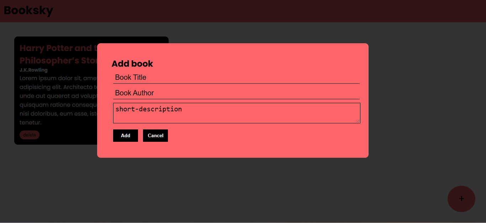

# 📚 Booksky – Book Management App

Booksky is a simple and interactive Book Management Web Application built using HTML, CSS, and JavaScript. It allows users to add books with a title, author, and description through an interactive popup form and dynamically remove books when they are no longer needed.

## 🌐 Live Demo

[](https://inthusha20241647-commits.github.io/booksky-book-management/)

## 📸 Screenshots

### 🖥️ Desktop View

<p align="center">
  
</p>

## ✨ Features

- 📖 **Book Display:** Displays books with their title, author, and description.
- ➕ **Add Books:** Allows users to add new books through a popup form.
- 📝 **Book Details:** Collects the book title, author's name, and description.
- 🗑️ **Delete Books:** Allows users to dynamically remove individual book entries.
- 💬 **Interactive Popup:** Provides a popup interface for adding new books.
- ❌ **Cancel Option:** Allows users to close the popup without adding a book.
- 📱 **Responsive-Friendly Layout:** Provides a layout designed to accommodate different screen sizes.
- 🎨 **Simple User Interface:** Uses clean styling and Poppins typography.

## 🛠️ Technologies Used

- HTML5
- CSS3
- JavaScript
- DOM Manipulation
- Google Fonts (Poppins)

## 📂 Project Structure

```text
booksky-book-management/
│
├── Screenshot.png
├── index.html
├── style.css
├── script.js
└── README.md
```

## 🚀 How to Run Locally

1. Clone the repository:

   ```bash
   git clone https://github.com/inthusha20241647-commits/booksky-book-management.git
   ```

2. Open the project folder in VS Code.
3. Open `index.html` using Live Server or directly in your browser.

No additional installation is required.

## 📖 How It Works

### Add a Book

1. Click the **+** button.
2. Enter the book title.
3. Enter the author's name.
4. Add a short description.
5. Click the **Add** button.
6. The book will appear on the page.

### Delete a Book

Click the **Delete** button on any book card to remove it from the page.

## 🎯 Learning Objectives

- Understand HTML structure and form elements.
- Practise CSS styling and layout design.
- Learn JavaScript DOM manipulation.
- Handle user interactions using event listeners.
- Dynamically create and remove HTML elements.
- Work with popup forms and user input.
- Build an interactive frontend application.

---

*Booksky is a frontend development project created as part of my continuous learning journey.*
